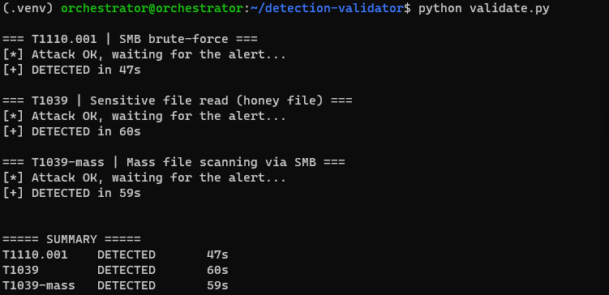
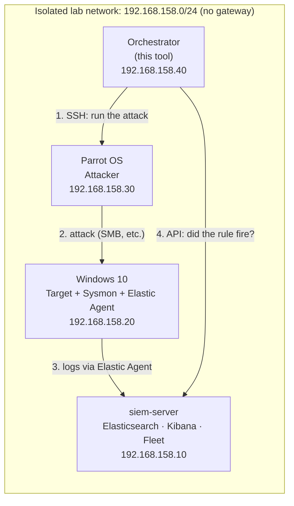
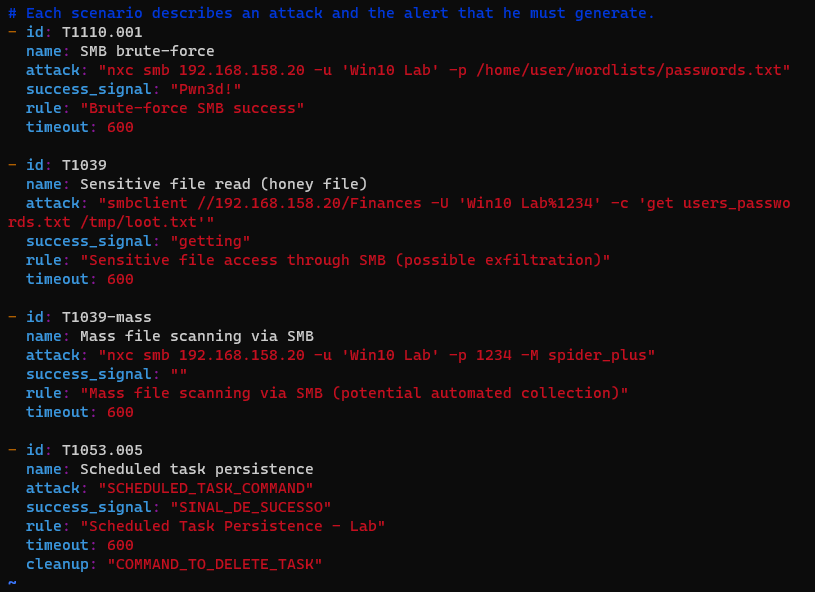
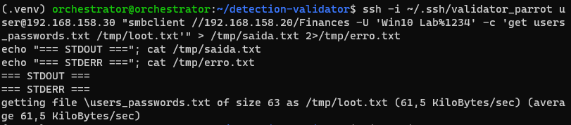
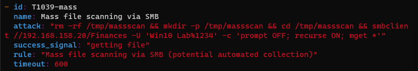
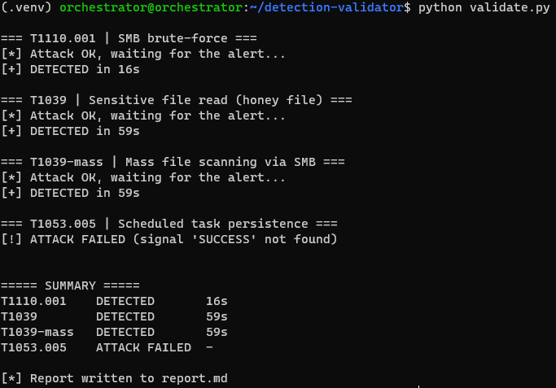

# SOC Detection Validator

A small Python tool that automatically **re-runs the attacks from my [SOC home lab](https://github.com/fogaccacbr/soc-home-lab) and checks whether each detection rule actually fired**, then writes a coverage report.

It turns a manual, error-prone routine — launch the attack, switch to Kibana, search for the alert, eyeball the result — into one command that produces a repeatable, timestamped report. The idea is the same one behind *detection validation* / *breach-and-attack simulation* used by purple teams: a rule that was built once is not a rule you can trust forever.



> Companion project to **[soc-home-lab](https://github.com/fogaccacbr/soc-home-lab)**, which builds the SIEM, the endpoint and the detection rules this tool exercises.

---

## Why this exists

While building the lab I validated every rule by hand. That worked once, but it doesn't survive change: the day I tweak a Sysmon config, update the Elastic Agent, or edit a rule, I have no quick way to know whether a detection silently broke. Manual testing also only ever proves "it worked that one time".

This tool answers a sharper question automatically, for every technique:

> *Did rule **X** produce an alert after I launched attack **Y**, and how long did it take?*

## What it does

For each scenario defined in `scenarios.yaml`, the tool:

1. Records the start time (UTC).
2. Launches the attack on the attacker VM over SSH.
3. Checks the attack's own output for a **success signal** — so a broken test is never mistaken for a missed detection.
4. Polls the Elasticsearch alerts indices until the expected rule fires or a timeout is reached.
5. Measures **time-to-detect** and, optionally, runs a cleanup command.

It then prints a summary and writes `report.md`.

## Architecture

The design rule is simple: **the attacker never talks to the SIEM.** Giving the offensive box read access to the defender's alerts is exactly backwards — in the real world an adversary who can see what was detected can tune around it. So the logic runs on a dedicated **orchestrator** VM on the defensive side, which drives the attacker over SSH and queries the SIEM over its API.



| Leg | Transport | Purpose |
|---|---|---|
| Orchestrator → Parrot | SSH (dedicated key) | Trigger the attack |
| Parrot → Windows | the attack itself | Generate the malicious activity |
| Windows → siem-server | Elastic Agent | Ship the logs |
| Orchestrator → siem-server | Elasticsearch API (HTTPS, API key) | Ask whether the alert appeared |

The orchestrator authenticates to Elasticsearch with a **read-only API key** scoped to the alert and log indices (least privilege): if it leaks, it can read alerts but not delete evidence or disable detections.

## Scenarios

Scenarios live in `scenarios.yaml`, decoupled from the code — adding a technique means adding a block, not editing Python.

```yaml
- id: T1110.001
  name: SMB brute-force
  attack: "nxc smb 192.168.158.20 -u 'Win10 Lab' -p <wordlist>"
  success_signal: "Pwn3d!"
  rule: "Brute-force SMB success"
  timeout: 600
```

| Field | Meaning |
|---|---|
| `id` / `name` | MITRE technique ID and a human label |
| `attack` | command run on the attacker over SSH |
| `success_signal` | text that must appear in the attack output to count as "attack ran" |
| `rule` | exact detection-rule name in Kibana |
| `timeout` | seconds to wait for the alert |
| `cleanup` | *(optional)* command to undo the attack (e.g. delete a scheduled task) |



## Three possible outcomes

The `success_signal` check is what makes the report trustworthy — it separates a problem with the *test* from a problem with the *detection*:

| Result | Meaning |
|---|---|
| **Detected** | attack ran and the rule fired |
| **Not detected** | attack ran but no alert — a real detection gap |
| **Attack failed** | the attack itself didn't run — fix the test, not the rule |

## Gap found, closed and proved

This is the loop the tool was built for.

**Before.** The lab already performed scheduled-task persistence (T1053.005), but no rule alerted on it. The validator made that blind spot explicit instead of letting it hide:

| Technique | Scenario | Rule | Result |
|---|---|---|---|
| T1110.001 | SMB brute-force | Brute-force SMB success | ✅ Detected |
| T1039 | Sensitive file read (honey file) | Sensitive file access through SMB | ✅ Detected |
| T1039-mass | Mass file scanning via SMB | Mass file scanning via SMB | ✅ Detected |
| T1053.005 | Scheduled task persistence | *(no rule)* | ❌ Not detected |

**Fix.** I wrote a KQL rule in Kibana that catches the task from two independent sources (full logic in [soc-home-lab/detections](https://github.com/fogaccacbr/soc-home-lab/blob/main/detections/README.md#4-scheduled-task-created-possible-persistence)):

```kql
event.code:"4698" or
(process.name:"schtasks.exe" and process.args:("/create" or "/Create" or "-create"))
```

and added a 4th scenario that creates the task remotely over SMB with NetExec, then deletes it in `cleanup` so every run starts from a clean host.

**After.**

```markdown
**Coverage: 4/4 techniques detected**

| Technique | Scenario | Rule | Result | Time to detect |
|---|---|---|---|---|
| T1110.001 | SMB brute-force | Brute-force SMB success | ✅ Detected | 30s |
| T1039 | Sensitive file read (honey file) | Sensitive file access through SMB | ✅ Detected | 58s |
| T1039-mass | Mass file scanning via SMB | Mass file scanning via SMB | ✅ Detected | 58s |
| T1053.005 | Scheduled task persistence | Scheduled task created (possible persistence) | ✅ Detected | 31s |
```


## Setup

Runs on the orchestrator VM (Ubuntu Server, Python 3.14; tested against Elastic Stack 9.5).

```bash
git clone https://github.com/fogaccacbr/soc-detection-validator
cd soc-detection-validator

python3 -m venv .venv
source .venv/bin/activate
pip install -r requirements.txt
```

Then provide the environment and access:

1. Copy `.env.example` to `.env` and fill in your Elasticsearch URL, **read-only** API key, and CA-cert path.
2. Copy the Elasticsearch CA certificate (`http_ca.crt`) to the orchestrator so the HTTPS connection is verified.
3. Set up an SSH key from the orchestrator to the attacker so attacks can run non-interactively.
4. Edit `scenarios.yaml` for your rule names and attack commands.

```bash
python validate.py
```

Nothing secret is committed: `.env`, the venv, certificates and generated reports are all gitignored.

## How it was built

I built this with AI assistance for the Python itself, while driving the architecture, debugging each step against the live lab, and validating the behaviour end to end. The engineering that matters here is in the design decisions and the troubleshooting, and those are documented below.

It came together incrementally, each step verified against the live lab before moving on: a raw `curl` to the alerts API → a Python query of recent alerts → a single automated scenario (attack → wait → detect) → multiple scenarios from YAML → the Markdown report. A few bugs along the way shaped the design:

- **The attacker shouldn't hold defensive credentials** → the orchestrator moved to its own VM on the defensive side.
- **"Not detected" and "attack never ran" are different failures** → the `success_signal` check was added so the report can't conflate them.
- **`smbclient` writes progress to stderr, not stdout** → one scenario reported `ATTACK FAILED` even though the download worked. Splitting the streams showed the signal was on stderr; the success check now reads both.

  

- **Re-downloaded files can skip reads and drop below the threshold** → the mass-scan scenario first looked `NOT DETECTED`; making each run wipe its download dir restored the full read count and the alert.

  

- **A half-configured scenario must not look like a missed detection** → the first run with the new scheduled-task scenario reported `ATTACK FAILED`, because the scenario wasn't fully configured in `scenarios.yaml` yet. Once it was set up properly, the next run reported `DETECTED`. This is what the three-outcome design is for: the report blamed the test, not the rule, so I fixed the test.

  

## Limitations & roadmap

- **Duplicate alerts.** The brute-force and mass-scanning rules each raise many alerts per incident. The validator only needs one, so it reports correctly, but the underlying rules want **alert suppression** (grouped by `source.ip`) — a tuning step this tool is well placed to measure before/after.
- **Timing is coarse.** Rules run on a schedule, so time-to-detect depends on where in the cycle the attack lands. A single run isn't a benchmark; averaging several would be.
- **Sequential and slow.** Each scenario waits for its own alert. Running all attacks first, then polling, would cut total runtime.
- [x] Write the `T1053.005` scheduled-task rule and add the 4th scenario — see [Gap found, closed and proved](#gap-found-closed-and-proved).
- [ ] Record results into an Elasticsearch index and build a Kibana coverage dashboard over time.
- [ ] Emit an [ATT&CK Navigator](https://mitre-attack.github.io/attack-navigator/) layer from the results.

## Disclaimer

Everything here runs in an isolated lab on machines I own, against intentionally weak test credentials created for the exercise. Do not use these techniques against systems you are not authorized to test.
